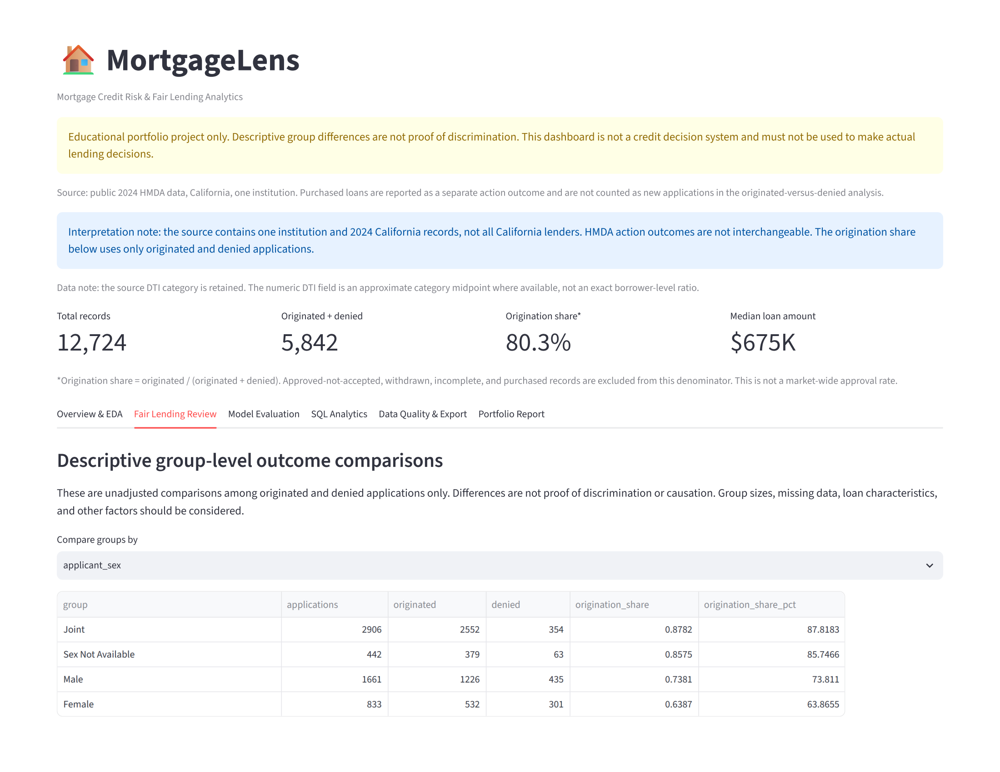
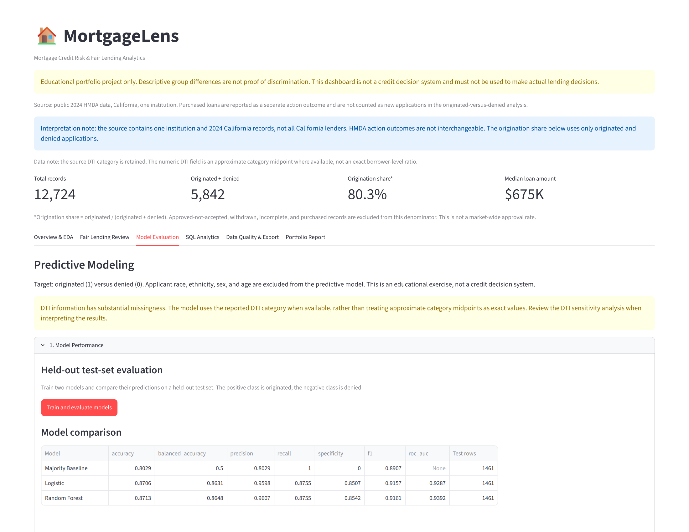
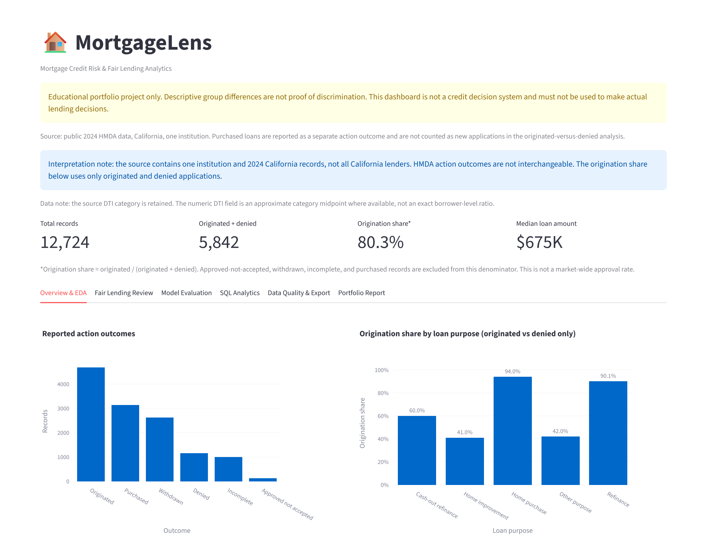
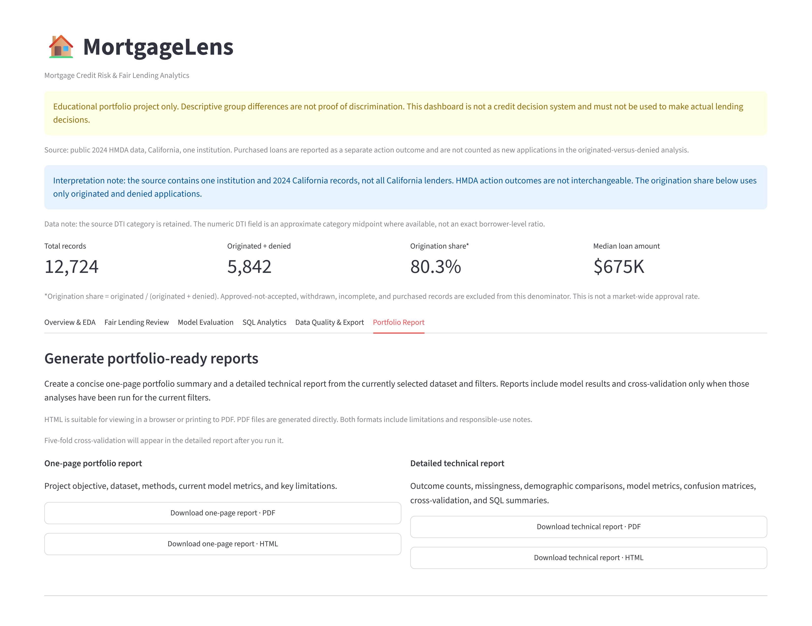

# MortgageLens: Mortgage Credit Risk & Fair Lending Analytics

MortgageLens is an interactive mortgage application analytics project built with Python, Pandas, NumPy, SQL, statistics, machine learning, Plotly, and Streamlit. It explores public Home Mortgage Disclosure Act (HMDA) data through data-quality checks, exploratory data analysis, demographic comparisons, model evaluation, SQL analytics, and automated reporting.

**[Open the Live MortgageLens Dashboard](https://mortgagelens-gswxgt936zqk8tacdsksk4.streamlit.app/)**

**[View the GitHub Repository](https://github.com/savithasundaresan/MortgageLens)**

---

## Dashboard Preview

### Fair Lending Review



### Model Evaluation



### Overview & EDA



### Portfolio Reports



*Screenshots are stored in the `screenshots/` directory. Ensure the filenames above match the actual files in your repository.*

---

## 1. Project Objectives

MortgageLens demonstrates an end-to-end analytical workflow for mortgage application data.

The project aims to:

- Validate and prepare public mortgage application data for analysis.
- Explore application outcomes, distributions, trends, and relationships between variables.
- Compare origination shares across demographic groups using descriptive statistics.
- Apply confidence intervals and two-proportion hypothesis testing where appropriate.
- Use SQL to summarize application outcomes and examine trends.
- Compare logistic regression and random forest classifiers using classification metrics.
- Evaluate data quality and document missingness.
- Generate downloadable portfolio and technical reports from the dashboard's current analytical results.

The dashboard demonstrates analytical methods and software development skills. It is not a mortgage underwriting system.

## 2. Data Sources and Interpretation

MortgageLens analyzes public HMDA mortgage application data and supports analysis-ready CSV uploads.

The prepared public HMDA dataset is used by the dashboard's analysis workflow. Source fields must be mapped to the analytical schema expected by the application.

### Official data sources

- [Consumer Financial Protection Bureau — HMDA Data](https://www.consumerfinance.gov/data-research/hmda/)
- [HMDA Loan/Application Register (LAR) Data Fields](https://ffiec.cfpb.gov/documentation/publications/loan-level-datasets/lar-data-fields/)

HMDA data describe reported mortgage application and loan outcomes. They do not, by themselves, establish whether a borrower is creditworthy or whether a loan will default.

### Important interpretation notes

- An originated-versus-denied classification predicts recorded application outcomes, not creditworthiness, repayment performance, or default risk.
- Withdrawn, incomplete, purchased, and other application dispositions must not automatically be treated as denials.
- Demographic differences in application outcomes are descriptive observations, not proof of discrimination.
- Differences between groups may reflect sample sizes, missing data, loan characteristics, geography, lender practices, or other factors requiring further investigation.
- Results depend on the dataset, reporting period, filters, field definitions, and analytical choices used.

This project is educational. It is not a credit underwriting tool, a legal opinion, or a finding of discrimination. Its models must not be used to make lending decisions.

## 3. Skills and Technologies

| Area | Skills and technologies |
|---|---|
| Programming | Python |
| Data manipulation | Pandas, NumPy |
| Data preparation | Validation, missing-value assessment, duplicate checks, feature engineering |
| Exploratory analysis | EDA, descriptive statistics, distributions, trends, relationships |
| Statistical analysis | Confidence intervals, two-proportion hypothesis testing |
| SQL analytics | SQL aggregations and analytical queries using DuckDB |
| Machine learning | Logistic regression, random forest |
| Model evaluation | Stratified train/test split, precision, recall, F1-score, specificity, balanced accuracy, ROC-AUC, confusion matrices |
| Visualization | Plotly |
| Dashboard development | Streamlit |
| Reporting | Automated PDF and standalone HTML reports |
| Testing | pytest |

## 4. Dashboard Features

### Overview & EDA

- Application outcome summaries and key metrics.
- Distributions and relationships among selected variables.
- Filters for the dimensions supported by the loaded dataset.
- Charts for exploring mortgage application outcomes.

### Fair Lending Review

- Descriptive comparisons of application outcomes across demographic groups.
- Group-level counts and rates.
- Statistical comparisons where applicable.
- Interpretation notes to discourage conclusions unsupported by the data.

Group comparisons are exploratory. A rate difference alone does not establish discrimination or explain its cause.

### Model Evaluation

- Logistic regression and random forest model comparison.
- A stratified training and test split.
- Classification metrics and confusion matrices.
- Cross-validation results when the cross-validation workflow has been run.
- Additional model diagnostics supported by the current implementation.

The target is based on recorded application outcomes. Model performance measures how well the model reproduces the selected outcome label; it does not establish an ability to predict default or determine a borrower's creditworthiness.

### SQL Analytics

- SQL-based summaries of application outcomes.
- Grouped and time-based analysis where the required fields are available.
- DuckDB queries integrated into the analytical workflow.

### Data Quality & Export

- Missing-value summaries.
- Data-quality checks.
- Review of the prepared dataset.
- Export functionality supported by the dashboard.

### Portfolio Report

The report generator produces four downloadable reports based on the current dashboard state.

| Report | Format | Purpose |
|---|---|---|
| One-page portfolio summary | PDF | Concise project overview and key findings |
| One-page portfolio summary | HTML | Standalone, browser-readable summary |
| Detailed technical report | PDF | Methods, results, data quality, and limitations |
| Detailed technical report | HTML | Standalone technical report |

The detailed report can include application outcome counts, missingness summaries, demographic comparisons, available model metrics, confusion matrices, cross-validation results when available, and SQL summaries.

To include model metrics, first run **Train and evaluate models** in the Model Evaluation tab. To include cross-validation results, run **Run cross-validation**. If you change the dataset or filters, rerun the relevant analyses before generating a report.

The report generator uses the current analytical results rather than hard-coded model metrics. Downloaded reports are generated for download and are not automatically saved into the project directory.

## 5. Project Structure

The following structure documents the main application, analysis modules, tests, SQL queries, and portfolio assets.

```text
MortgageLens/
├── .devcontainer/
├── data/
│   ├── processed/
│   └── raw/
├── screenshots/
│   ├── dashboard-overview.png
│   ├── fair-lending.png
│   ├── model-evaluation.png
│   └── portfolio-reports.png
├── sql/
│   └── analysis_queries.sql
├── src/
│   ├── __init__.py
│   ├── analysis.py
│   ├── data_prep.py
│   ├── modeling.py
│   ├── reporting.py
│   └── sql_analysis.py
├── tests/
│   ├── test_analysis.py
│   ├── test_data_prep.py
│   ├── test_modeling.py
│   ├── test_reporting.py
│   └── test_sql_analysis.py
├── .gitignore
├── app.py
├── README.md
└── requirements.txt
```

**Key files**

- `app.py` — Streamlit dashboard and application workflow.
- `requirements.txt` — Python dependencies.
- `src/analysis.py` — Statistical summaries and analysis.
- `src/data_prep.py` — Data preparation and validation.
- `src/modeling.py` — Model training and evaluation.
- `src/reporting.py` — PDF and HTML report generation.
- `src/sql_analysis.py` — SQL-based analytical functions.
- `sql/analysis_queries.sql` — SQL query examples.
- `tests/` — Automated tests for the project's analytical modules and report generator.
- `screenshots/` — Images used in the README.

**Note:** Keep the project structure synchronized with your actual repository. Remove any entry for a file or folder that does not exist. Do not commit credentials, virtual environments, temporary files, or private data.

## 6. Installation

Python 3.11 or 3.12 is recommended.

### Windows PowerShell

Open the project folder in VS Code and select **Terminal → New Terminal**.

Create a virtual environment:

```powershell
py -3.12 -m venv .venv
```

Activate it:

```powershell
.\.venv\Scripts\Activate.ps1
```

If PowerShell blocks activation, run:

```powershell
Set-ExecutionPolicy -Scope Process -ExecutionPolicy Bypass
.\.venv\Scripts\Activate.ps1
```

Install dependencies:

```powershell
python -m pip install --upgrade pip
python -m pip install -r requirements.txt
```

### macOS or Linux

Create and activate a virtual environment:

```bash
python3.12 -m venv .venv
source .venv/bin/activate
```

Install dependencies:

```bash
python -m pip install --upgrade pip
python -m pip install -r requirements.txt
```

## 7. Run the Tests

From the project root, with the virtual environment activated, run:

```bash
python -m pytest -q
```

The most recent local test run reported **16 passing tests**. Rerun the command after modifying the code or dependencies to verify the current checkout.

## 8. Run the Dashboard

From the project root, run:

```bash
streamlit run app.py
```

Open the local address displayed in the terminal.

Use the sidebar and dashboard controls to select an available data source, apply filters, explore the analysis, evaluate models, and generate reports.

The available data sources depend on which datasets are present and how they are configured in the application.

## 9. Analytical Methodology

### Data preparation

The preparation workflow validates fields required for analysis and handles data-quality issues supported by the implementation. Review missingness and field definitions before interpreting results.

For uploaded CSV files, ensure that the columns and data types match the requirements of the selected analysis. Arbitrary mortgage datasets may not share the same schema.

### Origination share

For the defined originated-versus-denied comparison, the origination share is:

\[
\text{Origination Share} =
\frac{\text{Originated Applications}}
{\text{Originated Applications}+\text{Denied Applications}}
\times 100
\]

Only applications with the specified originated or denied outcomes are included in this denominator. Other dispositions are excluded from this particular calculation.

This measure is conditional on the selected population. It is not necessarily the percentage of all records that were originated.

### Statistical comparisons

Descriptive statistics, confidence intervals, and two-proportion hypothesis tests can help investigate differences between groups.

Interpret statistical results in context. Consider sample size, uncertainty, missingness, multiple comparisons, confounding, and the definition of the population being compared.

Statistical significance alone does not establish practical importance, causation, or unlawful discrimination.

### Machine learning

The project compares logistic regression and random forest classifiers using a held-out test set and the evaluation metrics implemented in the application.

Metrics such as precision, recall, F1-score, balanced accuracy, specificity, and ROC-AUC describe different aspects of classification performance. No single metric establishes that a model is appropriate for lending decisions.

The models are educational demonstrations of a machine-learning workflow. They do not estimate borrower default probability or establish individual creditworthiness.

### SQL

DuckDB supports SQL-based summaries and analytical queries. SQL results should be interpreted using the filters, field definitions, and population applied to the current dataset.

## 10. Responsible Use and Limitations

MortgageLens is a portfolio and educational project.

- Do not use the models to approve, deny, price, or otherwise make decisions about actual credit applications.
- Do not interpret recorded application outcomes as labels of creditworthiness or future default.
- Do not treat group-level differences as proof of discrimination.
- Check group sizes, missing data, data quality, confounding, and the suitability of each statistical comparison.
- Confirm field definitions and reporting-period differences when working with HMDA data.
- Protect uploaded data that may contain personal or confidential information.
- Consult appropriate legal, compliance, and fair-lending experts for regulated analysis.

Public HMDA records are reported application data. They do not provide all the information needed to establish the reasons for an outcome or evaluate a lender's compliance with fair-lending law.

## 11. Potential Future Enhancements

Possible extensions include:

1. Add year-over-year analysis and uncertainty intervals.
2. Add lender-level comparisons and safeguards for small sample sizes.
3. Investigate group differences after stratifying by loan purpose, loan type, income, and geography.
4. Expand model calibration and threshold diagnostics for educational evaluation.
5. Document a data dictionary and model card.
6. Improve automated deployment checks and report regression tests.

These are potential extensions, not claims about functionality that is already implemented.

## 12. Project Links

- **Live dashboard:** [MortgageLens on Streamlit](https://mortgagelens-gswxgt936zqk8tacdsksk4.streamlit.app/)
- **Source code:** [MortgageLens on GitHub](https://github.com/savithasundaresan/MortgageLens)
- **Public data documentation:** [CFPB HMDA](https://www.consumerfinance.gov/data-research/hmda/)

MortgageLens demonstrates practical skills in data preparation, exploratory analysis, statistical testing, SQL, machine learning, dashboard development, automated reporting, and testing—with explicit limitations around model interpretation and fair-lending conclusions.